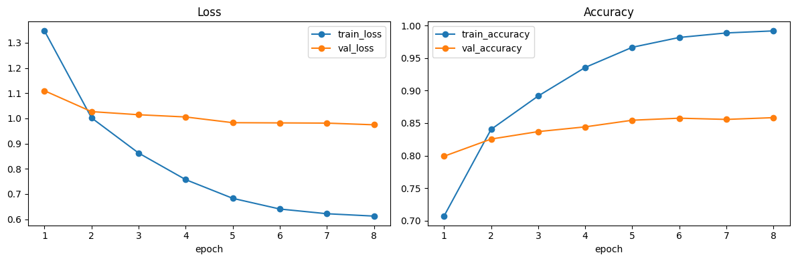
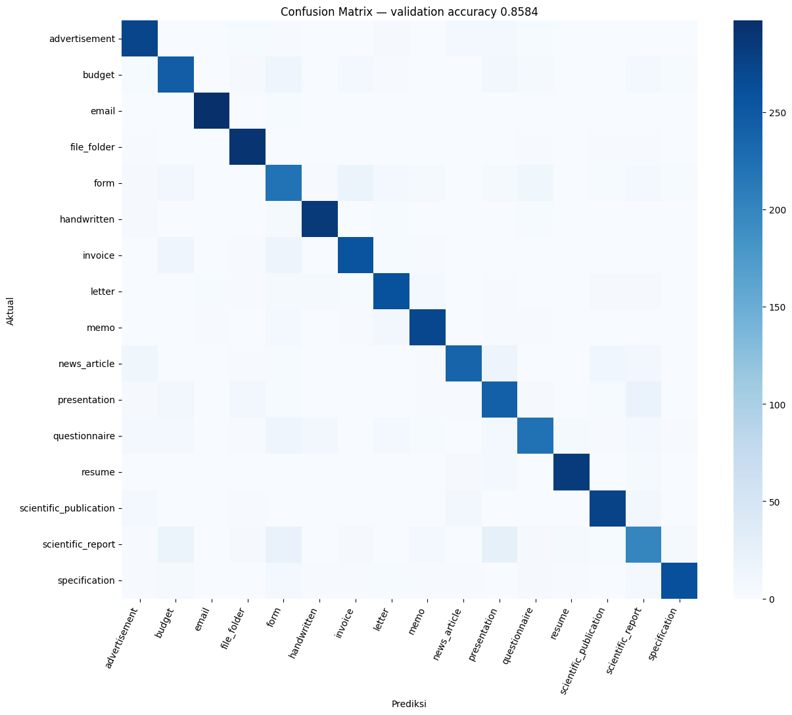

# Document Image Classification — Tugas 2 SML 2026

Klasifikasi 32.003 citra dokumen hasil scan ke 16 kelas menggunakan **PyTorch** dan transfer learning **ConvNeXt-Tiny**. Metrik kompetisi adalah multiclass accuracy. Implementasi memisahkan data train/validation secara stratified, menyimpan checkpoint terbaik berdasarkan validation accuracy, lalu menghasilkan submission `id,label` untuk 7.994 citra test.

## Ringkasan pendekatan

- **Baseline utama:** ConvNeXt-Tiny pretrained ImageNet dari `torchvision`.
- **Input:** citra TIFF dikonversi ke RGB, diputar mengikuti EXIF, diberi padding putih hingga persegi, lalu di-resize 224×224. Padding dipilih agar header, tabel, dan tata letak halaman tidak terpotong.
- **Validasi:** 15% stratified holdout dari `train.csv`; test kompetisi tidak pernah digunakan untuk memilih model.
- **Augmentasi:** rotasi kecil, autocontrast, serta jitter brightness/contrast. Horizontal flip tidak dipakai karena dapat merusak orientasi tulisan.
- **Optimasi:** AdamW, differential learning rate, cosine annealing, class-weighted cross entropy, label smoothing, mixed precision, dan early stopping.
- **Pemilihan model:** checkpoint dengan validation accuracy terbaik.

## Hasil eksperimen terverifikasi

| Metrik | Hasil |
|---|---:|
| Jumlah data train / validation / test | 27.202 / 4.801 / 7.994 |
| Epoch terbaik | 8 |
| Train accuracy epoch 8 | 0,9917 |
| Validation accuracy terbaik | **0,85836** |
| Validation loss epoch 8 | 0,9747 |
| Public leaderboard accuracy | **0,86407** |
| Selisih public score terhadap validation | +0,00571 |

Public score berasal dari submission `submission_convnext_tiny.csv` yang dinilai
Kaggle pada 26 Oktober 2026. Private score belum tersedia sebelum kompetisi
berakhir. Kedekatan public score dan validation accuracy menunjukkan bahwa holdout
stratified cukup representatif terhadap data leaderboard publik.

## Struktur repository

```text
document-image-classification/
├── README.md
├── requirements.txt
├── .gitignore
├── data/                         # tidak di-commit
├── models/                       # checkpoint besar tidak di-commit
│   ├── README.md                 # cara memperoleh checkpoint
│   └── model_metadata.json       # ukuran, skor, dan SHA-256 model
├── notebooks/
│   ├── 01_end_to_end_kaggle.py
│   └── 01_end_to_end_kaggle.ipynb    # versi tereksekusi
├── scripts/
│   ├── __init__.py
│   ├── config.py
│   ├── data.py
│   ├── model.py
│   ├── engine.py
│   ├── train.py
│   ├── predict.py
│   └── utils.py
├── reports/
│   ├── validation_metrics.json
│   └── figures/
│       ├── confusion_matrix.png
│       └── learning_curves.png
└── submissions/
    ├── README.md
    └── submission_convnext_tiny_public_0.86407.csv
```

## Data

Kompetisi: `document-image-classification-sd234504` (private competition).

Di Kaggle Notebook, gunakan **Add Input → Competition Data**. Kode otomatis mencari:

1. `/kaggle/input/document-image-classification-sd234504`
2. `/kaggle/input/competitions/document-image-classification-sd234504`
3. `data/` untuk eksekusi lokal

Untuk lokal, letakkan `train.csv`, `test.csv`, `sample_submission.csv`, folder `train/`, dan folder `test/` di `data/`. Dataset dan checkpoint model sengaja diabaikan Git agar mematuhi aturan tugas.

## Pemetaan workflow tutorial Tugas 1

Contoh Tugas 1 memisahkan workflow menjadi `01_eda.ipynb`,
`02_modeling.ipynb`, dan `03_submission.ipynb`. Pada repository ini ketiga tahap
tersebut disatukan secara berurutan dalam
`notebooks/01_end_to_end_kaggle.ipynb` agar **Save Version** Kaggle dapat
menjalankan eksperimen dari awal sampai menghasilkan submission dalam satu run:

| Tahap contoh | Implementasi pada notebook ini |
|---|---|
| EDA | pemeriksaan CSV, label, distribusi kelas, dan contoh citra |
| Modeling | stratified split, transform, ConvNeXt-Tiny, training, dan validasi |
| Submission | inferensi test, validasi format `id,label`, lalu ekspor CSV |

Strukturnya tetap mengikuti prinsip tutorial: notebook untuk eksperimen,
`scripts/` untuk kode reusable, `models/` untuk artefak model, `submissions/`
untuk prediksi, dan `reports/figures/` untuk visualisasi. Perbedaan algoritma
disengaja karena Tugas 2 mewajibkan PyTorch dan memperbolehkan neural network.

## Menjalankan secara lokal

```bash
python -m venv .venv
source .venv/bin/activate
pip install -r requirements.txt
python -m scripts.train --data-dir data --epochs 8 --batch-size 32
python -m scripts.predict --data-dir data --checkpoint models/convnext_tiny_best.pt
```

Output penting:

- `models/convnext_tiny_best.pt`: bobot model terbaik + konfigurasi + riwayat training. Karena berukuran sekitar 106 MiB, file tersedia melalui [GitHub Release v1.0-kaggle](https://github.com/patrudd/document-image-classification-sml/releases/tag/v1.0-kaggle), bukan riwayat Git.
- `reports/validation_metrics.json`: konfigurasi hasil, classification report, dan learning history.
- `reports/figures/confusion_matrix.png`: pola prediksi benar dan pasangan kelas yang tertukar.
- `reports/figures/learning_curves.png`: perbandingan loss/accuracy train dan validation.
- `submissions/submission_convnext.csv`: output default dari `scripts.predict` untuk eksekusi lokal.
- `submissions/submission_convnext_tiny_public_0.86407.csv`: submission terverifikasi yang memperoleh public score 0,86407.
- `/kaggle/working/submission_convnext_tiny.csv`: file notebook yang telah dinilai Kaggle.

## Menjalankan di Kaggle

1. Buka tab **Code** pada kompetisi dan buat notebook baru.
2. Aktifkan **GPU** dan **Internet**. Internet diperlukan sekali untuk bobot pretrained ImageNet.
3. Tambahkan competition data sebagai input.
4. Upload atau import `notebooks/01_end_to_end_kaggle.ipynb`.
5. Jalankan semua cell dan pastikan validation accuracy serta file submission muncul.
6. Unduh checkpoint dan submission dari `/kaggle/working/`.

Jika memori GPU tidak cukup, turunkan `batch_size` dari 32 menjadi 16. Jangan mengubah validation split ketika membandingkan eksperimen agar skor tetap adil.

## Strategi submission (batas 5/hari)

Gunakan submission secara hemat:

1. ConvNeXt-Tiny baseline yang lolos validasi lokal.
2. Perbaikan resolusi 288 jika GPU dan waktu cukup.
3. Ensemble hanya setelah dua model benar-benar memiliki error validasi yang berbeda.

Catat validation accuracy, konfigurasi, public score, dan nama file setiap submission. Public leaderboard hanya berbobot 10%; kualitas repository dan interpretasi berbobot 70%, sehingga eksperimen harus reproducible dan terdokumentasi.

## Interpretasi hasil

Train accuracy meningkat dari 0,7070 menjadi 0,9917, sedangkan validation
accuracy meningkat dari 0,7990 menjadi 0,8584. Selisih sekitar 13,3 poin
persentase pada epoch 8 menunjukkan model mulai overfit terhadap training split.
Meskipun demikian, validation accuracy tertinggi dan validation loss terendah
tetap terjadi pada epoch 8. Public score 0,86407 juga dekat dengan validation
accuracy, sehingga checkpoint tersebut tetap dipilih.

Kelas dengan performa paling kuat adalah `email` (F1 0,9802), `resume`
(F1 0,9373), `handwritten` (F1 0,9316), dan `file_folder` (F1 0,9299).
Kelas tersulit adalah `scientific_report` (F1 0,6944), `form` (F1 0,7106),
`presentation` (F1 0,7769), dan `questionnaire` (F1 0,7957). Dokumen tersebut
memiliki tata letak yang dapat menyerupai kelas lain; confusion matrix perlu dibaca
terutama pada kesalahan `form` menuju `questionnaire`/`invoice`,
`scientific_report` menuju `presentation`/`form`, serta sebagian `letter`–`memo`.





Distribusi training relatif seimbang, dari 1.948 gambar pada `questionnaire`
hingga 2.056 pada `scientific_publication`. Class-weighted loss tetap digunakan
sebagai perlindungan ringan agar kelas yang lebih sedikit tidak diabaikan, bukan
sebagai koreksi untuk ketimpangan ekstrem.

Satu TIFF korup pada kelas `scientific_publication` tidak dapat dibaca PIL.
Loader menangani kasus ini secara deterministik dengan menggantinya menggunakan
halaman putih agar keseluruhan training tidak gagal. Dampaknya terbatas pada satu
sampel dari 32.003 gambar.

## Reproducibility dan batasan

Seed default adalah 42. PyTorch/CUDA tetap dapat memiliki sedikit variasi numerik.
Bobot pretrained berasal dari ImageNet, bukan dari test set kompetisi. Test set
Kaggle hanya digunakan untuk inferensi akhir dan tidak pernah digunakan untuk
pemilihan model atau hyperparameter. Notebook yang disimpan di repository sudah
dieksekusi penuh, sedangkan dataset, checkpoint 106 MB, dan submission CSV tidak
di-commit untuk mematuhi ketentuan ukuran dan kerahasiaan kompetisi.
